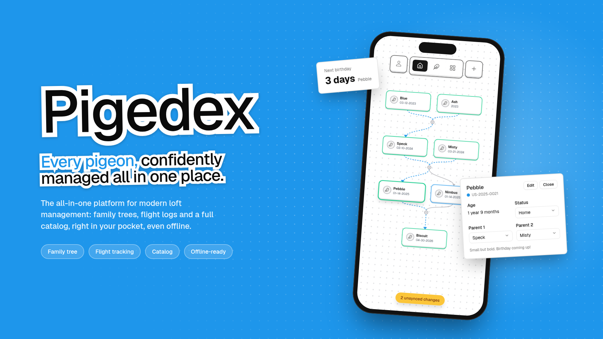

  <h1 align="center">🐦 Pigedex 🐦</h1>
  <h3>All in one solution for modern loft management</h3>

The [Pigedex](https://pigedex.joshuamarkle.com) is a progressive web app designed for pigeon coop management. It provides tools for tracking lineage, managing pigeon records, and logging flights through an interactive and visual interface.

 

## ✨ Features
- Family tree/Catalog of pigeons
- Flight management
- Supported PWA (progressive web app)
- User authentication
- Overall working MVP

## 🚨 Known Issues
- Only supports single user (but is extensible)
- Minor UX challenges

## 🚀 Future Improvements
- Picture uploads
- Use current location feature
- Address
- Flight planner
- Badges/awards

## 🙏 Attribution

This project uses these services:
- [Leaflet Interactive Maps](https://leafletjs.com/)
- [Nominatim Address Search Engine](https://nominatim.openstreetmap.org/ui/about.html)
